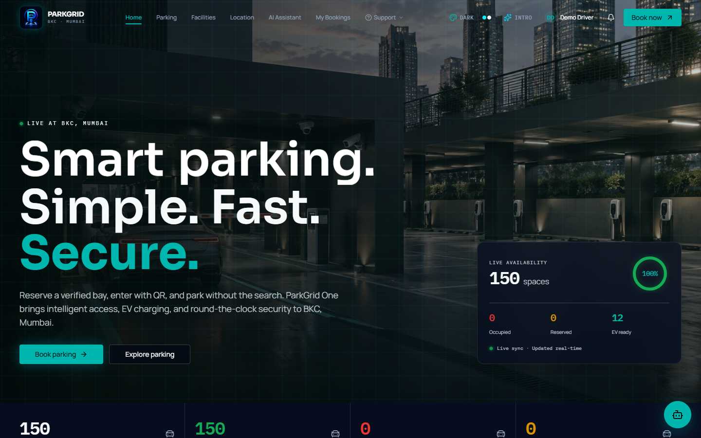
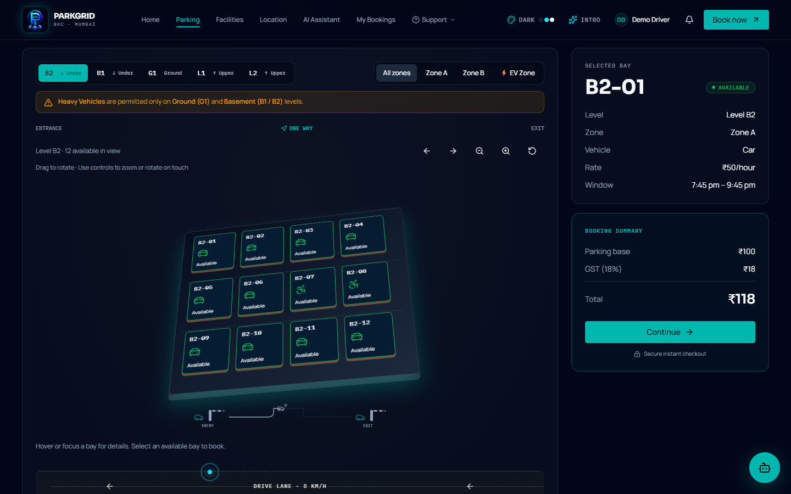
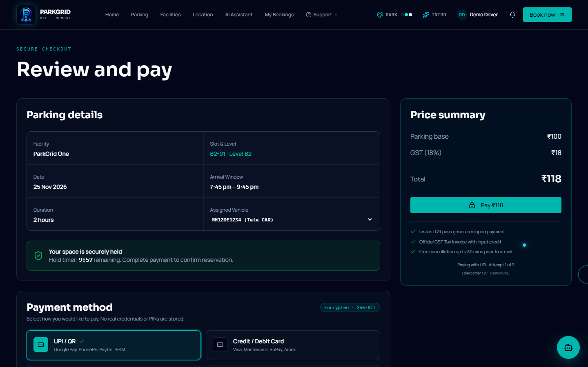
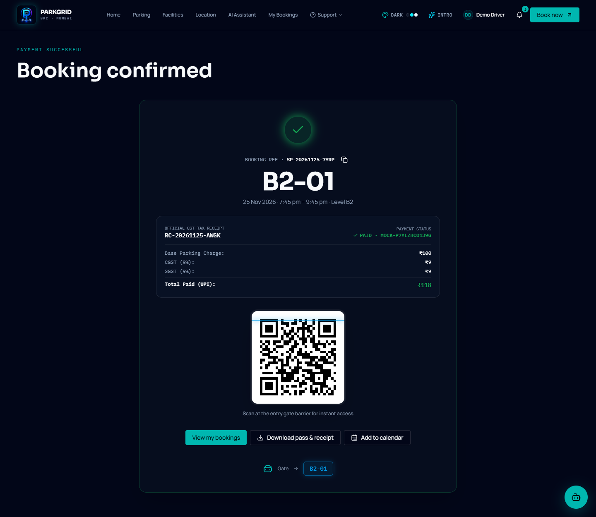
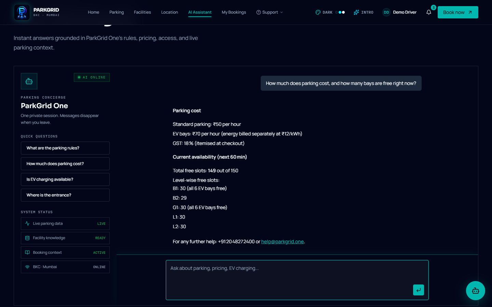
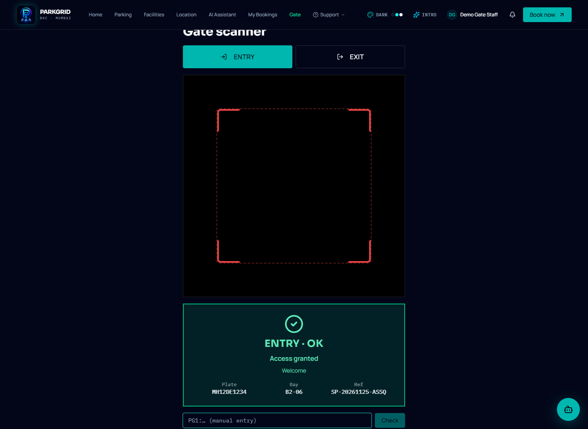
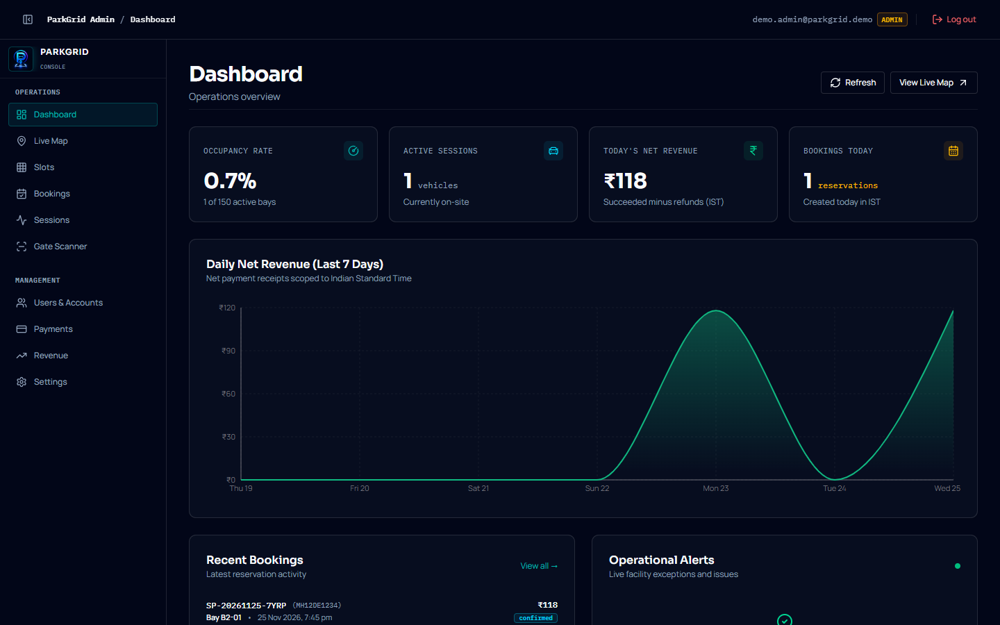
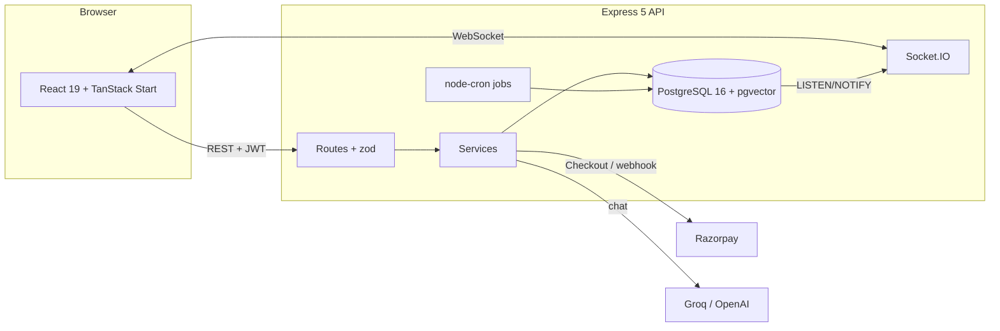

<div align="center">

# 🅿️ ParkGrid One

**A full-stack smart-parking platform: book a bay, pay, get a QR pass, scan in and out, and ask an AI assistant, all backed by PostgreSQL.**


[Live demo](#live-demo) · [Features](#features) · [Architecture](#architecture) · [Quick start](#quick-start) · [Docs](#documentation)

</div>

> Originally a Supabase-backed prototype. The backend was rebuilt as an **Express 5 + PostgreSQL** service with hand-written SQL, and the existing TanStack Start frontend was rewired to it. See [docs/AUDIT.md](docs/AUDIT.md) for what was wrong in the original and what changed.

---

## Live demo

> Add your deployed URL here: `https://<your-site>.workers.dev`

The API runs on a free tier and sleeps when idle, so the **first load can take 30–60 seconds**. Payments use a **mock gateway**, so nothing real is charged.

| Role | Email | Try |
|---|---|---|
| Driver | `demo.member@parkgrid.demo` | Book a bay, pay, see your QR pass |
| Gate staff | `demo.staff@parkgrid.demo` | Open `/gate`, scan or paste the `PG1:` code |
| Admin | `demo.admin@parkgrid.demo` | Dashboard, users, refunds, audit log, knowledge base |

The password is whatever `DEMO_PASSWORD` was set to on the server.

## Screenshots

<p align="center">
  
</p>

<table>
  <tr>
    <td width="50%"><br><sub><b>Pick a bay</b>: 3D level map, live availability, price breakdown</sub></td>
    <td width="50%"><br><sub><b>Checkout</b>: 10-minute hold, GST breakdown, payment methods</sub></td>
  </tr>
  <tr>
    <td width="50%"><br><sub><b>Confirmation</b>: GST receipt and an opaque QR pass for the gate</sub></td>
    <td width="50%"><br><sub><b>AI assistant</b>: grounded answers using live availability and pricing tools</sub></td>
  </tr>
  <tr>
    <td width="50%"><br><sub><b>Gate scanner</b>: staff scan the pass, entry is validated and recorded</sub></td>
    <td width="50%"><br><sub><b>Admin console</b>: occupancy, sessions, revenue, alerts, audit log</sub></td>
  </tr>
</table>

---

## Features

**Driver journey**
sign up → add vehicle → pick a bay on a live map → 10-minute hold → pay → confirmation with an opaque QR pass → staff scans entry → live session → staff scans exit → receipt and notifications.

- **No double booking, by construction.** A PostgreSQL exclusion constraint (`EXCLUDE USING gist` on slot + time range) plus a row lock on the slot. Verified with 25 parallel requests for the same bay: exactly one wins.
- **Payments.** Razorpay flow (server order → Checkout → signature verify + webhook) with idempotent confirmation, event de-duplication, and automatic refund if payment lands after the hold expired. A mock gateway is the default so the whole app works without keys.
- **Money done carefully.** Integer paise only, GST computed with integer rounding, IST used only for display.
- **Gate scanning.** Opaque 192-bit QR tokens (no data inside), idempotent entry/exit scans, `too_early` / `expired` handling, overstay charges recorded.
- **Realtime.** Postgres `LISTEN/NOTIFY` triggers → one dedicated listener → Socket.IO rooms, so availability and booking status update live.
- **RAG parking assistant.** pgvector retrieval over an official knowledge base plus live tools (availability, pricing, hours, *your* booking). Works with Groq (free), OpenAI, or a retrieval-only fallback with no key. Prompt-injection and out-of-scope questions are deflected; retrieval is evaluated in CI (28/28 hit@5).
- **Admin console.** Dashboard, revenue reports, users, bookings, refunds, audit log, knowledge-base editor with a retrieval test box.

**Security**
Argon2id password hashing · 15-minute JWT access tokens + rotating, hashed refresh tokens with reuse detection · helmet, CORS allow-list, per-route rate limits · zod validation on every input · HMAC signature checks with `timingSafeEqual` · audit log for admin actions · secrets only via environment. Details: [docs/SECURITY.md](docs/SECURITY.md).

---

## Architecture



| Layer | Choices |
|---|---|
| Frontend | React 19, TanStack Start/Router/Query, Tailwind, `socket.io-client`, `@ai-sdk/react`, `@yudiel/react-qr-scanner` |
| API | Express 5, TypeScript (strict, ESM), `pg` with hand-written SQL, `node-pg-migrate` (plain SQL up/down), zod 4, `jose`, `@node-rs/argon2`, pino, socket.io |
| Database | PostgreSQL 16, `btree_gist`, `pgvector` (HNSW), advisory locks for cron |
| AI | Vercel AI SDK, offline hashed embedder or OpenAI embeddings, Groq/OpenAI chat |
| Quality | vitest + supertest against real Postgres, ESLint, GitHub Actions, Docker |

Why SQL instead of an ORM, why these constraints, and the trade-offs: [docs/ARCHITECTURE.md](docs/ARCHITECTURE.md) and [docs/DATABASE.md](docs/DATABASE.md).

```
smart-parking/
├── backend/     API, migrations (001–010), seeds, 101 tests, Dockerfile
├── frontend/    TanStack Start app; src/lib/api/* is the API client
├── docs/        architecture, API, database, payments, realtime, RAG, security, runbook
├── .github/     CI (tests, RAG eval, audit, docker build) and optional deploy
└── render.yaml  one-click free-tier API blueprint
```

---

## Quick start

**Prerequisites:** Node 22+, Docker Desktop.

```powershell
# 1. Database and a fake mail inbox
cd backend
docker compose up -d postgres mailpit

# 2. API
copy .env.example .env      # then edit secrets as needed
npm install
npm run migrate
npm run seed                # parking layout + pricing + knowledge base
$env:ADMIN_SEED_EMAIL="you@example.com"; $env:ADMIN_SEED_PASSWORD="a-long-password-12+"; npm run seed:admin
npm run dev                 # http://localhost:4000

# 3. Web app (new terminal)
cd ..\frontend
copy .env.example .env      # VITE_API_URL=http://localhost:4000
npm install
npm run dev                 # http://localhost:8080
```

Outgoing emails appear in Mailpit. Everything works with **no external keys**: payments are mocked and the assistant falls back to retrieval-only. Add `GROQ_API_KEY` to `backend/.env` for real assistant answers (free key from console.groq.com).

More: [docs/RUNBOOK.md](docs/RUNBOOK.md).

---

## Testing and CI

```powershell
cd backend
npm run ci          # typecheck + lint + 101 tests + build
npm run rag:eval    # retrieval quality: hit@1 / hit@5, out-of-scope, injection
```

Tests run against a real Postgres (not mocks) and cover migrations round-trip, auth and token reuse, booking concurrency, payments and webhooks, gate scans, admin, realtime and RAG. GitHub Actions runs them with a pgvector service, plus `npm audit`, the frontend build and a Docker build.

---

## Deploy for free

Neon (Postgres) + Render (API) + Cloudflare (web). Step by step in [docs/DEPLOY-FREE.md](docs/DEPLOY-FREE.md).

---

## Documentation

| Doc | What's inside |
|---|---|
| [AUDIT](docs/AUDIT.md) | Problems found in the original and the fixes |
| [ARCHITECTURE](docs/ARCHITECTURE.md) | Modules, request flow, decisions |
| [API](docs/API.md) | Endpoint reference |
| [DATABASE](docs/DATABASE.md) | Schema, constraints, migrations |
| [PAYMENTS](docs/PAYMENTS.md) | Razorpay flow, idempotency, refunds |
| [REALTIME](docs/REALTIME.md) | LISTEN/NOTIFY → Socket.IO |
| [RAG](docs/RAG.md) | Retrieval, tools, evaluation |
| [SECURITY](docs/SECURITY.md) | Threat model and controls |
| [RUNBOOK](docs/RUNBOOK.md) | Operating it, plus honest limitations |
| [LEARNING](docs/LEARNING.md) | Concepts explained for students |

---

## Known limitations

Stated plainly rather than hidden:

- Real Razorpay and real OpenAI paths are not exercised end to end (the mock gateway and Groq are).
- No load testing or `EXPLAIN` tuning yet.
- With Razorpay, overstay charges are recorded as `due` but not collected automatically.
- The offline embedder is lexical, and its synonym list was tuned on the same question set used for evaluation, so 100% hit@5 is optimistic on unseen wording.
- This is a portfolio project, not a hardened production service.

---

## License

[MIT](LICENSE)
